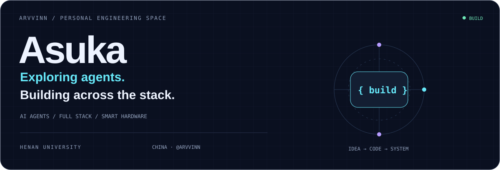
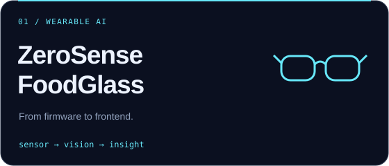
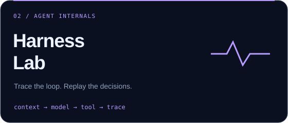
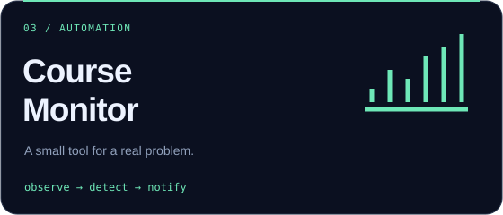
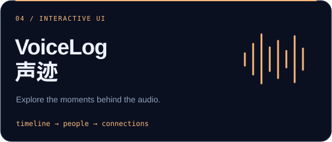
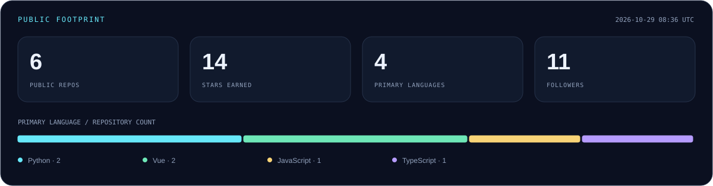

  

  <a href="https://github.com/Arvvinn?tab=repositories"><b>Projects / 项目</b></a> &nbsp; · &nbsp;
  <a href="https://voicelog-shengji-arvvinn.netlify.app/"><b>Live demo / 在线体验</b></a> &nbsp; · &nbsp;
  <a href="https://github.com/Arvvinn/claude-code-harness-lab"><b>Agent lab / 研究笔记</b></a>

 

### 把想法做成可以运行的东西。

Hi, I'm **Asuka** — 河南大学，关注 **AI Agent、全栈应用与智能硬件**。

从 Agent 的工具调用与上下文流，到前后端、ESP32 固件与可打印结构件，我喜欢顺着一个问题把系统做完整，也把过程整理成能读懂、能运行的代码与文档。

*Exploring how agents work. Connecting software with the physical world.*

 

### 01 / Selected builds

<table>
<tr>
<td width="50%" valign="top">

<b>从硬件到应用的完整链路</b> 
饮食识别智能眼镜原型：姿态检测、图像上传、AI 营养估算，连接前端、后端与可穿戴硬件。  
<code>Vue 3</code> <code>Spring Boot</code> <code>ESP32</code> <code>MySQL</code>  
<a href="https://github.com/Arvvinn/ZeroSense-FoodGlass">Explore source ↗</a> · <a href="https://github.com/Arvvinn/ZeroSense-FoodGlass-CN">中文文档 ↗</a>
</td>
<td width="50%" valign="top">

<b>沿着调用链理解 Agent</b> 
基于上游代码的个人学习实验：研究工具调用、上下文组装、provider 适配，以及可回放的 Harness Trace。  
<code>TypeScript</code> <code>Bun</code> <code>CLI</code> <code>JSONL Trace</code>  
<a href="https://github.com/Arvvinn/claude-code-harness-lab">Explore the lab ↗</a>
</td>
</tr>
<tr>
<td width="50%" valign="top">

<b>让重复检查变成及时提醒</b> 
本地浏览器读取课程余量，定时检查并通过飞书发送提醒，辅助用户定位有余量的课程。  
<code>JavaScript</code> <code>Node.js</code> <code>Browser automation</code>  
<a href="https://github.com/Arvvinn/course-availability-monitor">Explore source ↗</a>
</td>
<td width="50%" valign="top">

<b>让声音记录变得可探索</b> 
个人声音记录交互原型：时间线、人物交汇、关系图与原话回溯，提供可操作的在线演示。  
<code>HTML / CSS / JS</code> <code>Cytoscape.js</code> <code>Python</code>  
<a href="https://voicelog-shengji-arvvinn.netlify.app/">Try live demo ↗</a> · <a href="https://github.com/Arvvinn/voicelog-shengji-demo">Source ↗</a>
</td>
</tr>
</table>

 

### 02 / Working toolkit

**Agent engineering** &nbsp; 工具调用 · 上下文流 · CLI · Trace 与回放 
**Full-stack development** &nbsp; Vue / uni-app · Spring Boot · MySQL · API 集成 
**Hardware & automation** &nbsp; ESP32 · 固件 · 浏览器自动化 · 消息提醒

 

### 03 / Open-source signals

由公开仓库数据自动生成。语言分布按仓库主语言计数，代表项目使用情况。

 

### 04 / Keep building

<picture>
  <source media="(prefers-color-scheme: dark)" srcset="./assets/contributions-dark.svg" />
  <source media="(prefers-color-scheme: light)" srcset="./assets/contributions.svg" />
  
</picture>

  

  Curious about the internals. Serious about making things work. 
  <a href="https://github.com/Arvvinn">@Arvvinn</a> · Asuka

